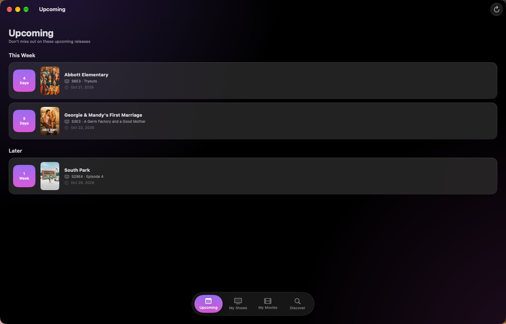
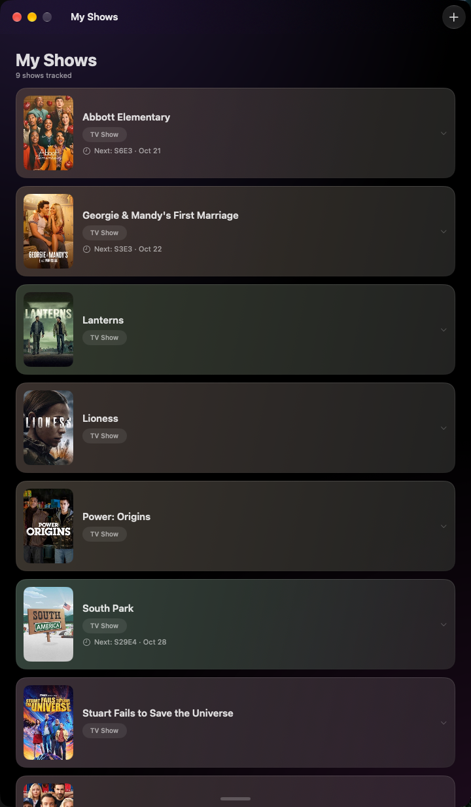
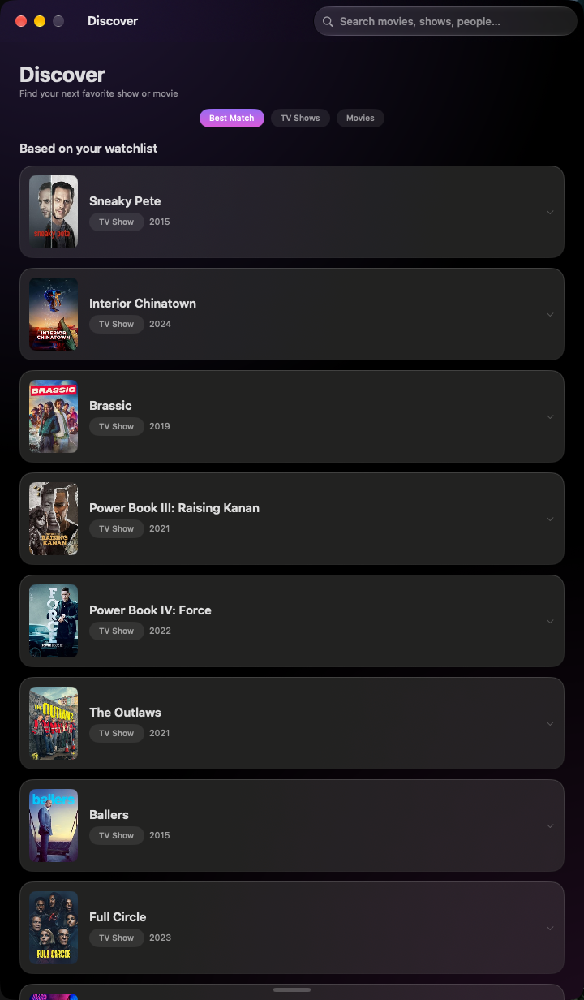
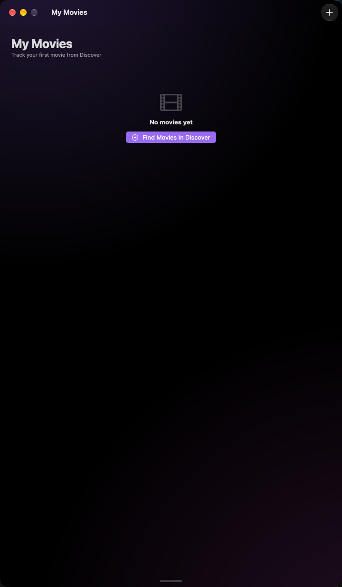

# Airpisode


Never miss what's next.

Airpisode is a macOS app that tracks when your TV shows and movies come out. It reads metadata from TMDB, keeps your watchlist on your Mac, and notifies you before a release. No account, no server, no sync.

## Screenshots

| Upcoming | My Shows |
| --- | --- |
|  |  |
|  |  |

## Features

- **Upcoming dashboard**: groups releases into Today, This Week, and Later, each with a countdown.
- **Watchlist**: tracks shows and movies, with the next episode or release on each row.
- **Episode tracking**: lists seasons and episodes, and marks what has aired.
- **Release dates**: shows theatrical, digital, physical, and TV windows by region.
- **Search**: searches TMDB and suggests titles based on what you track.
- **Notifications**: alerts you before an episode or release, with a lead time you choose. Episode air times come from TVmaze when available.
- **Poster-tinted cards**: each row picks a subtle color from its poster.
- **Offline library**: stores your watchlist as JSON, so it loads without a network.

## Install

Airpisode ships as a disk image. Download the latest `Airpisode-<version>.dmg`, open it, and drag Airpisode to your Applications folder. The build is not notarized, so macOS may warn on first launch: right-click Airpisode and choose Open.

The app ships without an API key. On first launch it asks for your own free TMDB key, walks you through getting one, and saves it on your Mac. Change it any time in Settings.

Get a key from [TMDB API settings](https://www.themoviedb.org/settings/api).

## Requirements

- macOS 13 or later
- A TMDB API key

To build from source you also need Xcode 15 or later and XcodeGen.

## Build and run

1. Copy the example config and add your key:

```bash
cp Airpisode/TMDBKey.xcconfig.example Airpisode/TMDBKey.xcconfig
```

2. Generate the project and open it:

```bash
xcodegen generate
open Airpisode.xcodeproj
```

3. Run the app with ⌘R.

`Airpisode.xcodeproj` is generated from `project.yml`, and `TMDBKey.xcconfig` holds your key. Neither is tracked, and you should never commit your key. A key entered in Settings overrides the xcconfig.

## Development

Build and test from the command line:

```bash
xcodegen generate
xcodebuild test -project Airpisode.xcodeproj -scheme Airpisode -destination 'platform=macOS'
```

Build a disk image with no key baked in:

```bash
./Scripts/build-dmg.sh
```

The image lands in `dist/`. See [CONTRIBUTING.md](CONTRIBUTING.md) for conventions.

The same steps run automatically on GitHub Actions: pushes to `main` and pull
requests execute the test suite keylessly, and pushing a `v*` tag builds the
DMG and publishes it as a GitHub release with its sha256 in the notes.

## How it works

Airpisode has no backend. It reads dates from TMDB and exact TV air times from TVmaze, then keeps your library in Application Support. It never invents a release time: when no air time is known, the app shows the day only and skips time-based alerts.

## Data and privacy

Your library lives at `~/Library/Application Support/Airpisode/library.json`, and your key is stored in your app preferences. Airpisode sends your key and search terms to TMDB, and show identifiers to TVmaze to look up episode air times. There is no analytics and no telemetry.

## Attribution

This product uses the TMDB API but is not endorsed or certified by TMDB.

Episode air times are provided by [TVmaze](https://www.tvmaze.com).

## License

[MIT](LICENSE)
